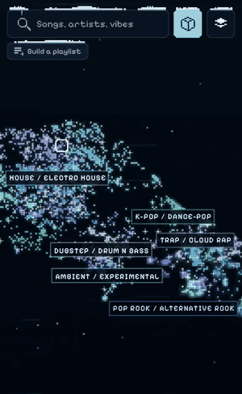
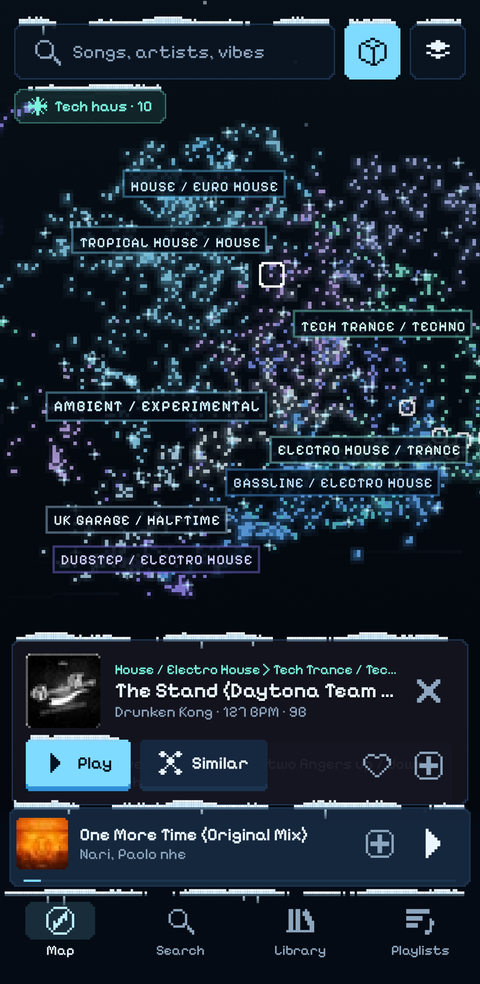
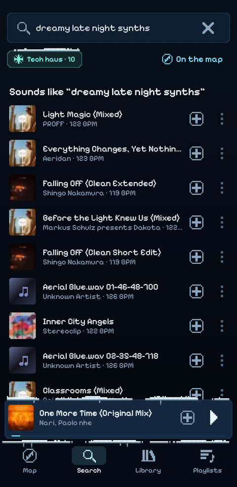
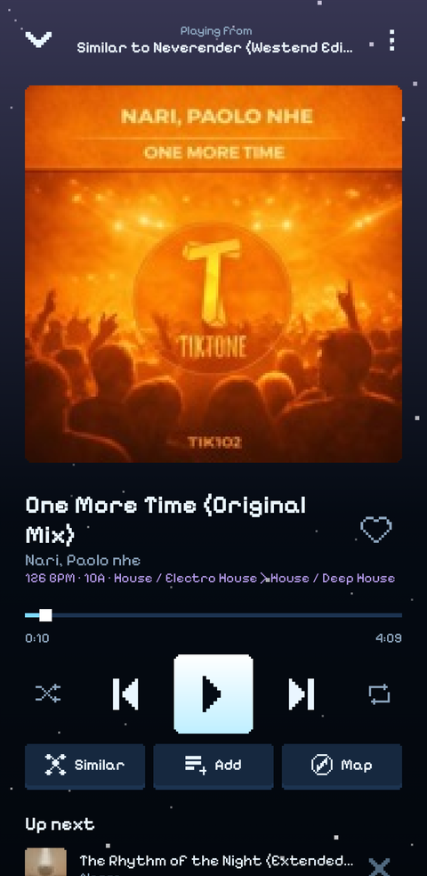
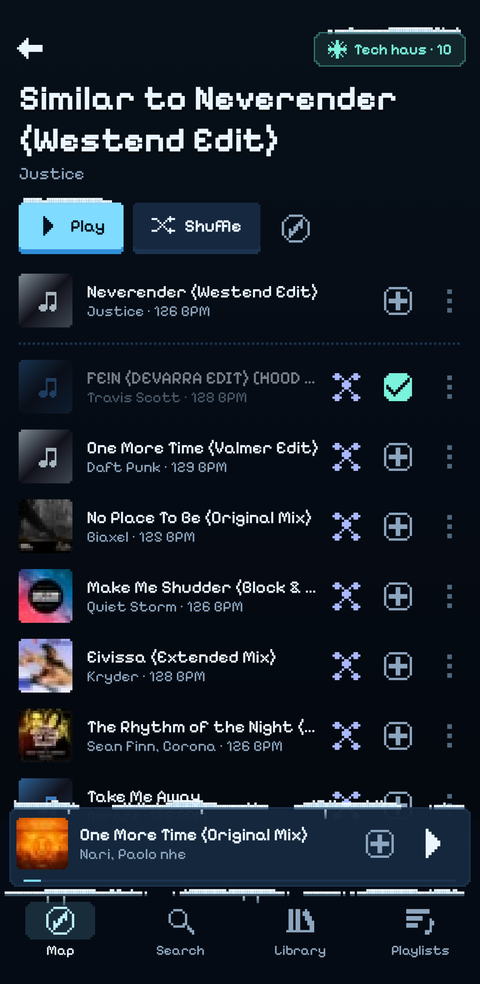
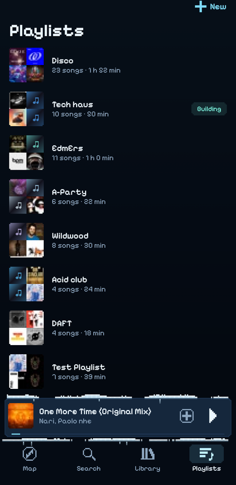
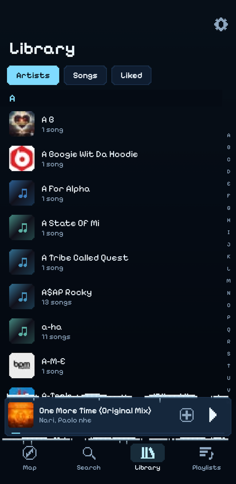
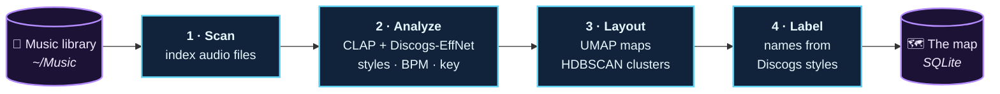
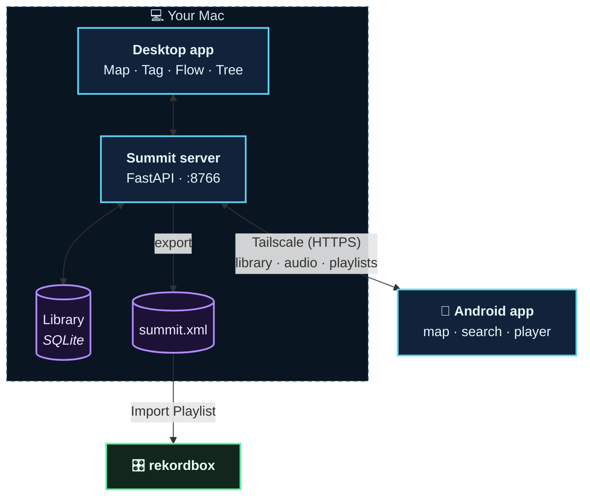

<h1 align="center">Summit</h1>

<p align="center">
  <b>A map of your music library, arranged by how the tracks actually sound.</b><br>
  Explore it, search it by vibe, build playlists and DJ sets, and take it with you on your phone.
</p>

<p align="center">
  
</p>

---

Summit listens to every track in your Music library with two audio models (CLAP and Discogs-EffNet) and lays the
library out as a map: tracks that sound alike sit together, and dense regions become named genre families and
sub-genres. Everything runs locally on your Mac. A native desktop app and an Android app share the same library, and
playlists go straight to rekordbox.

## Highlights

- **A map of your sound.** 2D or 3D, with families and sub-clusters named automatically from Discogs styles, and
  three embedding spaces to switch between (CLAP, EffNet, combined).
- **Search by vibe.** Type "dreamy late night synths" and get tracks that sound like that, alongside ordinary
  title and artist matches.
- **"Sounds like" everywhere.** From any track, jump to its nearest neighbours on the map, or grow a whole playlist
  by following them (Tree mode).
- **DJ tools.** BPM and key for every track, Flow mode to route a set through the map, and one-step export to
  rekordbox that keeps your original, lossless files.
- **Tags that learn.** Tags start as zero-shot audio prompts and retrain on your own picks once you've confirmed a
  few. "Teach a vibe" turns any selection into a new tag.
- **On your phone.** The full library, map, search, playlists and player on Android, streamed from your Mac over
  Tailscale. Playlists sync both ways.
- **Two looks.** Classic (glowing neon) and Pixel (retro 8-bit), on desktop and phone.

## The phone app

<table>
  <tr>
    <td align="center"><br><sub>The map, with named genre families</sub></td>
    <td align="center"><br><sub>Search by vibe</sub></td>
    <td align="center"><br><sub>Now playing: BPM, key, genre</sub></td>
  </tr>
  <tr>
    <td align="center"><br><sub>Tracks that sound similar</sub></td>
    <td align="center"><br><sub>Playlists, synced with the Mac</sub></td>
    <td align="center"><br><sub>The whole library, A to Z</sub></td>
  </tr>
</table>

## How it works

### Building the map



1. **Scan** indexes `~/Music/Music/Media.localized`. It's incremental and takes seconds. Files shorter than 60 s
   or longer than 12 min (samples, DJ mixes, recordings) are skipped.
2. **Analyze** computes CLAP and Discogs-EffNet embeddings, Discogs styles, BPM and key, at about 1.7 tracks/s. It
   can be stopped and resumed at any time.
3. **Layout** builds the maps with UMAP, then finds *families* where the embedding has real density gaps, split into
   *sub-clusters* only where a family has stable internal structure. There are no fixed cluster counts.
4. **Label** names each cluster from its most distinctive Discogs styles, so sub-clusters contrast with their
   siblings. You can rename either level in the app.

`summit update` runs all four steps, and each one only processes what changed.

### Where everything runs



One FastAPI server on your Mac serves the library, audio and API to both apps. Your data lives in `data/` and never
leaves the Mac except to stream to your own phone over your private tailnet.

## Getting started

**Requirements:** macOS (Apple silicon recommended), [uv](https://docs.astral.sh/uv/), Python 3.11 (uv installs it),
and `ffmpeg` (`brew install ffmpeg`). The EffNet model downloads automatically; CLAP comes from the Hugging Face cache.

```sh
uv run summit update      # scan + analyze + layout + label: build the map (the first run takes a while)
uv run summit app         # open the desktop app (or --browser to serve at http://127.0.0.1:8766)
```

### Commands

| Command | What it does |
|---|---|
| `summit update` | Bring the map up to date with the library: scan, analyze, layout, label |
| `summit scan` · `analyze` · `layout` · `label` | Run one step on its own |
| `summit app [--browser]` | Open the desktop app |
| `summit status` | Library counts, and what's waiting to be analyzed or placed |
| `summit service install` · `uninstall` · `restart` | Run the server in the background at login |
| `summit transcode` | Convert lossless tracks for the phone in advance |
| `summit export` | Write rekordbox XML and `.m3u8` playlists to `data/exports/` |
| `summit bundle` | Build `~/Applications/Summit.app` |

**After adding music,** run `summit update`. A running server reloads automatically when the run finishes, so just
refresh the desktop or phone app.

## Desktop app

The desktop app is a native macOS window (pywebview / WebKit, so AIFF and ALAC play natively) with four modes:

- **Map:** explore, build playlists, and name clusters. Toggle 3D.
- **Tag:** tag tracks in bulk.
- **Flow:** route a DJ set through the map, stage by stage.
- **Tree:** grow a playlist by following "sounds like".

The header switches map labels (Genres / Subgenres; with both on, they follow the zoom level), the look, and the
interface language (English / 日本語).

<details>
<summary>Keyboard shortcuts</summary>

| Keys | Action |
|---|---|
| <kbd>space</kbd> | Play / pause |
| <kbd>⇧</kbd><kbd>←</kbd> · <kbd>⇧</kbd><kbd>→</kbd> | Previous / next track |
| <kbd>⌥</kbd> + hover | Audition a track |
| <kbd>ctrl</kbd> + drag | Lasso select (<kbd>⇧</kbd> adds to the selection) |
| <kbd>esc</kbd> | Clear the selection |
| <kbd>⌘</kbd><kbd>Z</kbd> · <kbd>⇧</kbd><kbd>⌘</kbd><kbd>Z</kbd> | Undo / redo in Flow |
| <kbd>⌘</kbd><kbd>K</kbd> | Add a stage in Flow |
| <kbd>ctrl</kbd><kbd>alt</kbd><kbd>⇧</kbd><kbd>D</kbd> | Toggle help tips |

</details>

## Phone (Android)

The app in `android/` streams from your Mac. Setup:

1. **Keep the server running** in the background: `uv run summit service install`. The desktop app attaches to it
   instead of starting its own.
2. **Share it on your tailnet:** `tailscale serve --bg 8766`.
3. **Install the app:** `cd android && ./gradlew installDebug`. This needs Android Studio's JDK and SDK, with the
   phone connected over USB.
4. In the app, go to **Library → ⚙** and enter `https://<your-mac>.<tailnet>.ts.net`.

Lossless tracks are converted to 256 kbps AAC the first time they're played. Run `summit transcode` to convert them
all up front so every track starts instantly. The phone buffers up to 10 minutes ahead to ride out patchy
connections, and caches recently played songs. Settings shows the app and server versions, which come from git.

> **Tip:** keep the Mac awake on the charger (System Settings → Battery → Options → *Prevent automatic sleeping on
> power adapter when the display is off*). The screen can still turn off.

## rekordbox

`summit export` (or Export in the desktop app) writes `data/exports/summit.xml`. Every track points to its **original
file**, so lossless stays lossless.

1. In rekordbox, open Preferences → Advanced → Database → **rekordbox xml** and set *Imported Library* to
   `data/exports/summit.xml`.
2. Turn on Preferences → View → Layout → **rekordbox xml** to show it in the sidebar.
3. Open **rekordbox xml → Playlists → summit**, right-click a playlist, and choose **Import Playlist**.

The XML is only a read-only source to browse: Summit never touches rekordbox's own database. After re-exporting,
click the refresh icon next to "rekordbox xml" in the sidebar.

## Customising

- **Tags** are defined in `TAGS` in `src/summit/config.py`. Once a tag has 5 confirmed tracks, it retrains as a
  classifier on your picks.
- **Embedding spaces** (CLAP / EffNet / Combined) are defined in `SPACES` in `config.py`. To try another model, store
  its vectors under a new kind, add a space, and run `summit layout`.
- **Looks** are sets of design tokens. See `DESIGN.md` and `NEXT.txt`.

## Project layout

```
src/summit/      Python package: pipeline (scan, analyze, layout, label), FastAPI server, desktop app
  web/           Desktop UI (Map, Tag, Flow, Tree; three.js for 3D)
android/         Android app (Kotlin, Jetpack Compose, Media3, OpenGL map)
scripts/         App icon and app-bundle builders
docs/images/     Screenshots for this README
mockups/         Throwaway UI mockups from the design phase
data/            Your library database, caches and exports (gitignored)
models/          Downloaded models (gitignored)
```

Design notes live in `DESIGN.md` (visual language) and `PLAN.md` (architecture and decisions).
